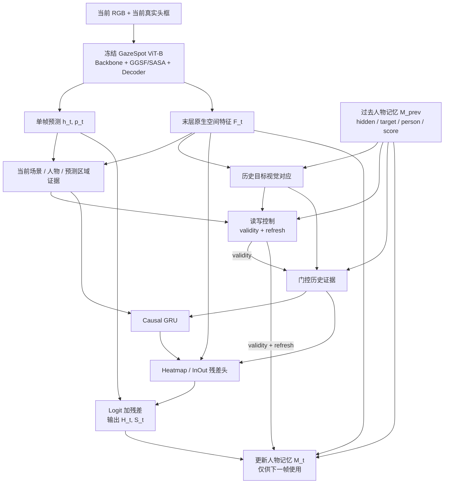
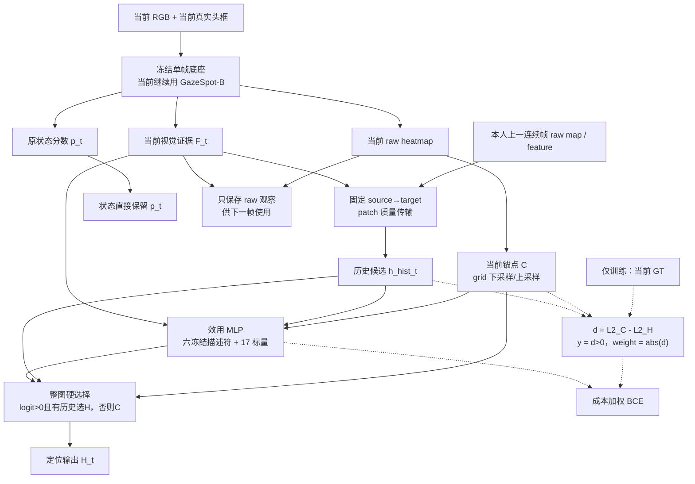
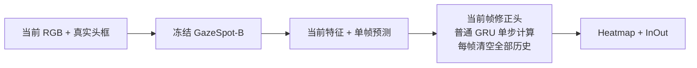

# 方法架构、实现状态与下一步

2026-11-20。图一是原已评测联合残差；图二是已完成真实训练/验收的D6成本监督选择门；图三是已评测D4对照。D6最佳输出等同无历史grid，尚无额外历史收益。三者不是串联成一套模型。

## 1. 已实现：冻结底座＋门控历史＋GRU联合残差

冻结底座同时提供完整单帧预测和backbone末层特征；图中不能理解为原GazeSpot decoder只用这个末层缓存。当前feature为768×32×32，预测热图64×64，InOut为标量。

- `validity` 控制历史对应证据、旧hidden与旧InOut的读入；`refresh` 参与目标模板写入。
- 输出是 `sigmoid(logit(raw_prediction) + residual)`。当前空间网格保留，但尚无显式“对齐历史热图候选＋当前预测”的融合。
- HV虽然保存过去heatmap，`step` 并不直接读取它；过去预测通过加权目标模板进入对应路径。
- 人物/连续段开始按metadata重置，只看当前/过去帧；GT注视点和状态只用于训练loss、离线计分，不进入模型输入或历史。
- D3增加稳定/转换训练loss，推理仍是上图。D2是独立的最终状态分数校准对照，不反馈历史，也不自动并入上图。

对应代码：[history_model.py](/Users/fanb/src/gazelle/cscwd/code/stag/history_model.py:56)、[temporal_model.py](/Users/fanb/src/gazelle/cscwd/code/stag/temporal_model.py:48)。目前这套实现尚未建立超过强EMA/普通GRU的核心时序优势。

## 2. D6：强当前锚点＋成本监督历史选择（真实结果已验收）

**结果 `4bbfdad` 已验收。按原规则选epoch1，test历史选择0，输出等同current_grid；后四轮采用历史后AUC/L2/稳定均下降。原InOut保持。§17.1仅保留复现。**

新门直接学习两候选的L2效用差，较大补救/伤害有较大损失权重。GT只进入train loss，不参与观察/候选/重置/记忆；门输出也不反馈raw历史。候选图幅值不同，因此选择完整图，不做线性混合。无历史强制当前锚点。

实现见 `utility_selector.py`、`selector_bank.py`、`selector_evaluation.py` 和 `train_utility_selector.py`；规格 `r4_utility_selector_plan.md`。先一次生成冻结bank，再单模型五轮/逐轮完整test/AUC选整轮。对照含raw、grid、raw-EMA、grid-EMA、always-transport。固定InOut使AP、状态错误/翻转和leave响应保持，只评价定位—稳定—响应折中。

## 3. D4：当前帧无历史对照（真实结果已验收）

D4保留普通GRU的当前输入和双输出结构，每帧清空hidden、过去heatmap与score，因此没有跨帧信息。它是归因对照，不是图二的额外推理模块，也不要求把图一、图二和D4全部串联。

结果 `6eeb594` 已通过235项小报告核对，选epoch5。D4 AP0.893067、leave107/192，重现了原AP/出画收益；准确稳定10,050窗与gaze87/158仍低于单帧。普通GRU五个同epoch AUC仍略高，不能据此说历史完全无用。当前停止扩大旧GRU/HV，转向检验显式候选的补救空间。

当前任务顺序：D6已验收（grid test稳定56.7084%、gaze91/158；最佳门与它完全相同）→D7冻结train效用诊断→根据实际收益决定结构。诊断复用五个checkpoint/train bank，比较二候选GT参考与常数cost先验，分解选择收益/伤害和regret；不直接追加训练。

当前保持GazeSpot-B。官方Gazelle与ViT-L用于机制出现增量后的公开复现/跨底座验证，详见 [方向复盘](/Users/fanb/src/gazelle/cscwd/idea_feasibility_review.md)。D6完整真实结果已记录，本次只验收和确定诊断计划，没有新增服务器任务。
