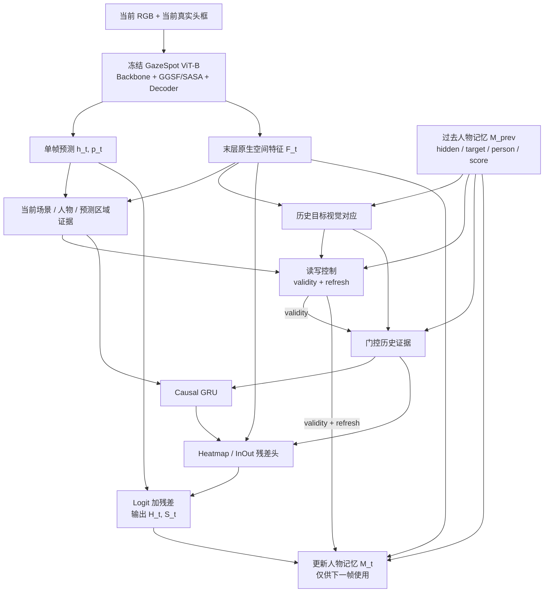
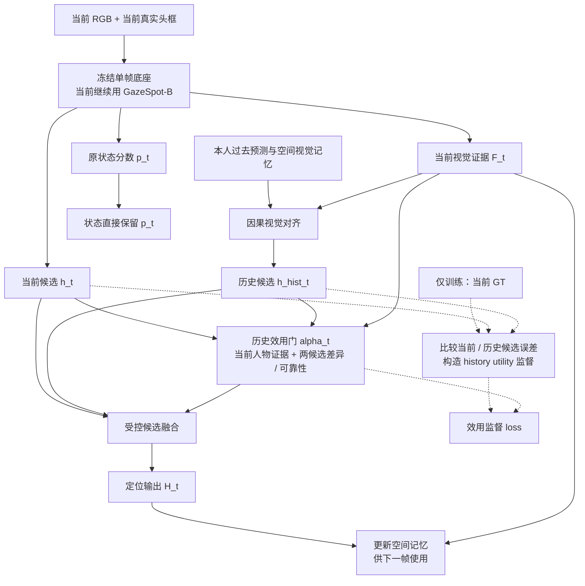

# 方法架构、实现状态与下一步

2026-11-19。图一是已实现/已评测的方法；图二是讨论中的选择门重构；图三是已评测的D4对照。当前D5只实现固定历史候选及train效用分析，尚未训练图二选择门。三者不能串成已经完成的同一套模型。

## 1. 已实现：冻结底座＋门控历史＋GRU联合残差

冻结底座同时提供完整单帧预测和backbone末层特征；图中不能理解为原GazeSpot decoder只用这个末层缓存。当前feature为768×32×32，预测热图64×64，InOut为标量。

- `validity` 控制历史对应证据、旧hidden与旧InOut的读入；`refresh` 参与目标模板写入。
- 输出是 `sigmoid(logit(raw_prediction) + residual)`。当前空间网格保留，但尚无显式“对齐历史热图候选＋当前预测”的融合。
- HV虽然保存过去heatmap，`step` 并不直接读取它；过去预测通过加权目标模板进入对应路径。
- 人物/连续段开始按metadata重置，只看当前/过去帧；GT注视点和状态只用于训练loss、离线计分，不进入模型输入或历史。
- D3增加稳定/转换训练loss，推理仍是上图。D2是独立的最终状态分数校准对照，不反馈历史，也不自动并入上图。

对应代码：[history_model.py](/Users/fanb/src/gazelle/cscwd/code/stag/history_model.py:56)、[temporal_model.py](/Users/fanb/src/gazelle/cscwd/code/stag/temporal_model.py:48)。目前这套实现尚未建立超过强EMA/普通GRU的核心时序优势。

## 2. 推荐讨论的重构：显式历史候选＋效用选择

**选择门尚未实现或训练；D5已实现固定空间候选的train分析，保持原InOut。**

旧门间接控制记忆读写；新门直接对应“历史候选在这一帧是否比当前预测有帮助”，并有相应监督。train GT只进入loss，不参与候选生成、推理门控或记忆；候选生成也不使用过去GT。

对齐、候选表达、融合形式和写入规则需在实际实现前固定；本图描述研究方向，不表示这些细节已完成。固定InOut时AP、状态错误/翻转和leave响应保持原值，只对定位稳定、enter/gaze_shift等相关效果提出主张。

## 3. D4：当前帧无历史对照（真实结果已验收）

D4保留普通GRU的当前输入和双输出结构，每帧清空hidden、过去heatmap与score，因此没有跨帧信息。它是归因对照，不是图二的额外推理模块，也不要求把图一、图二和D4全部串联。

结果 `6eeb594` 已通过235项小报告核对，选epoch5。D4 AP0.893067、leave107/192，重现了原AP/出画收益；准确稳定10,050窗与gaze87/158仍低于单帧。普通GRU五个同epoch AUC仍略高，不能据此说历史完全无用。当前停止扩大旧GRU/HV，转向检验显式候选的补救空间。

当前任务顺序：

1. **D5本地完成**：只在train生成current、分辨率参考、previous_raw、EMA0.75和视觉质量传输候选，28项生成/计分/CLI合成检查通过。规格 `r4_history_utility_plan.md`；候选全量落盘后GT计分，oracle不写回记忆。
2. **用户运行分析**：GPU1唯一nohup命令见实现计划§16.1，回传候选四象限、稳定/变化组与固定InOut阻断统计；不训练模型或读取test。
3. **候选有效再训练门**：依据补救/伤害与可观察信号，固定一版显式效用监督选择规则，再实现图二门控。GT选择参考不作为模型成绩或视频信息理论上限。

当前保持GazeSpot-B。官方Gazelle与ViT-L用于机制出现增量后的公开复现/跨底座验证，详见 [方向复盘](/Users/fanb/src/gazelle/cscwd/idea_feasibility_review.md)。D5尚无真实运行数字，图二选择门仍为候选研究方向。
