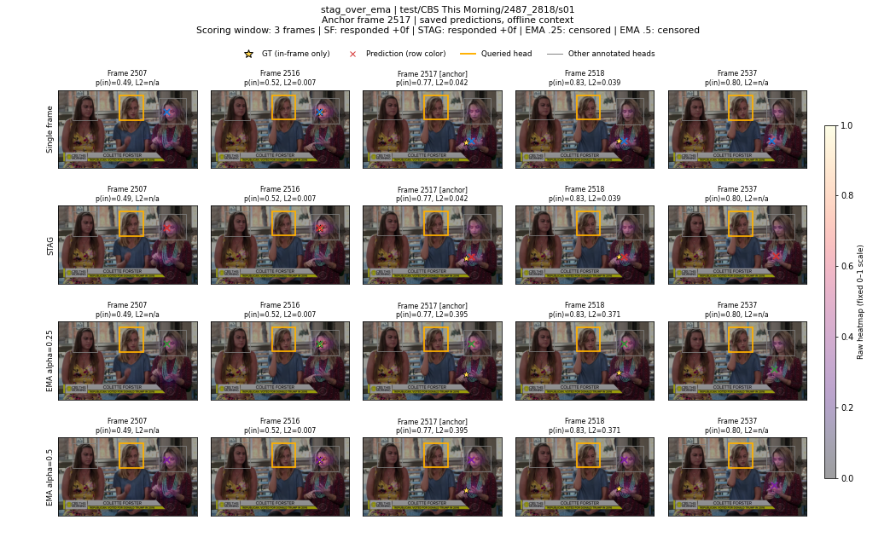
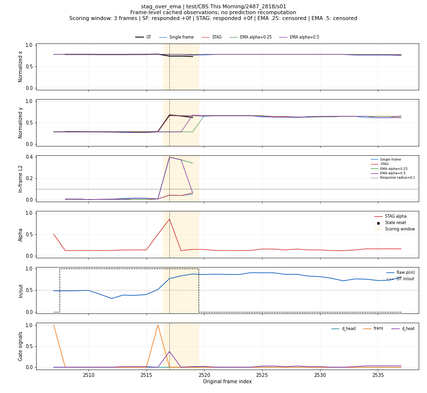
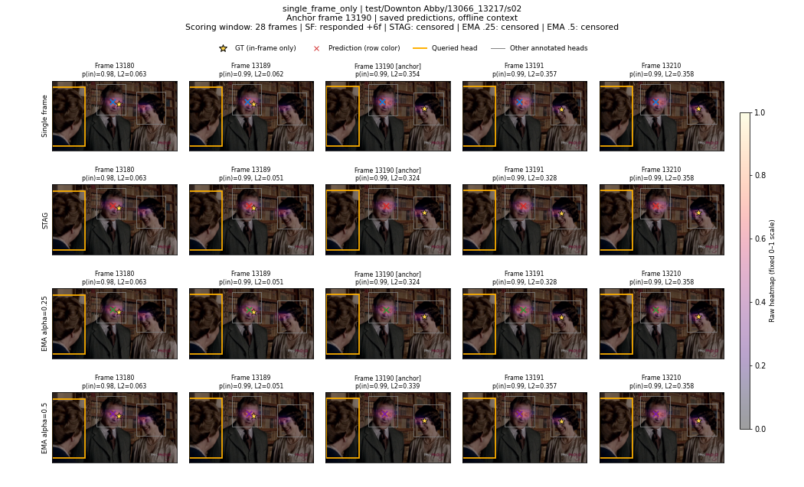
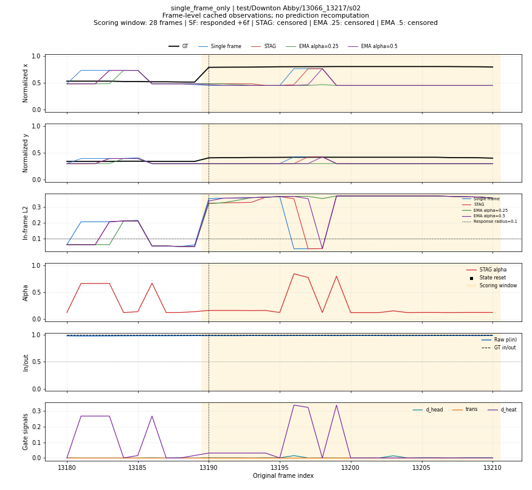
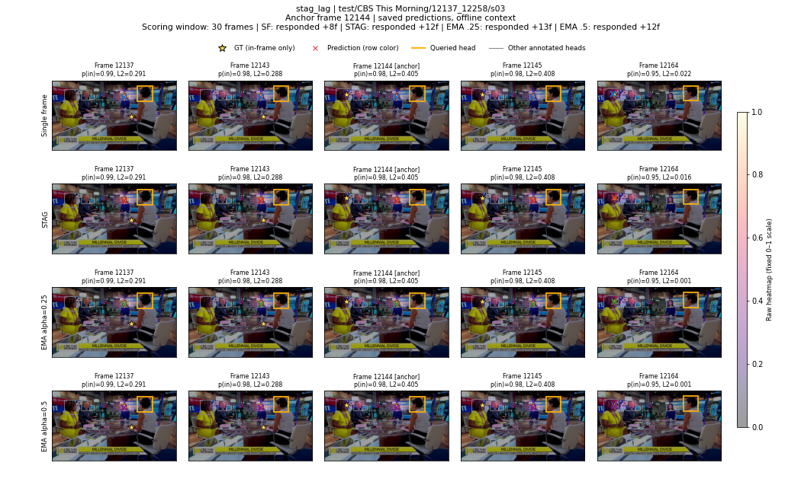
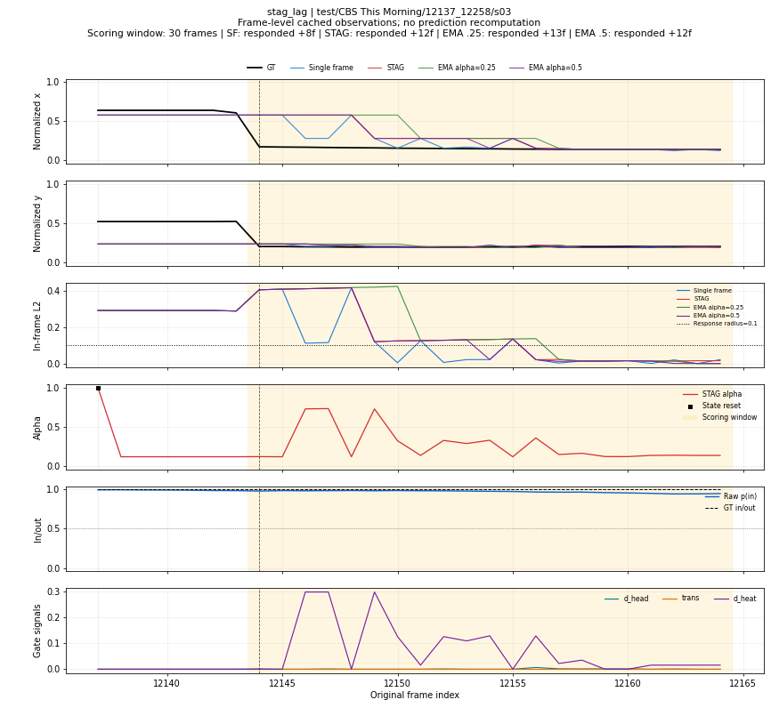
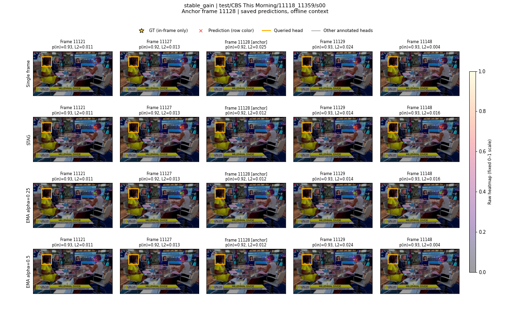
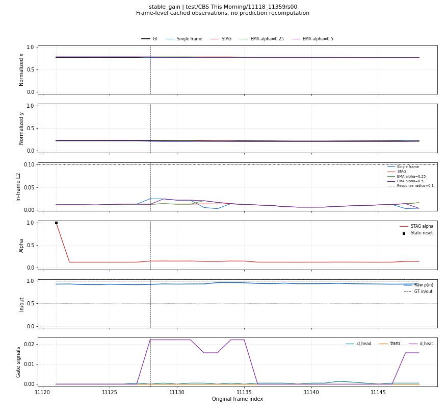
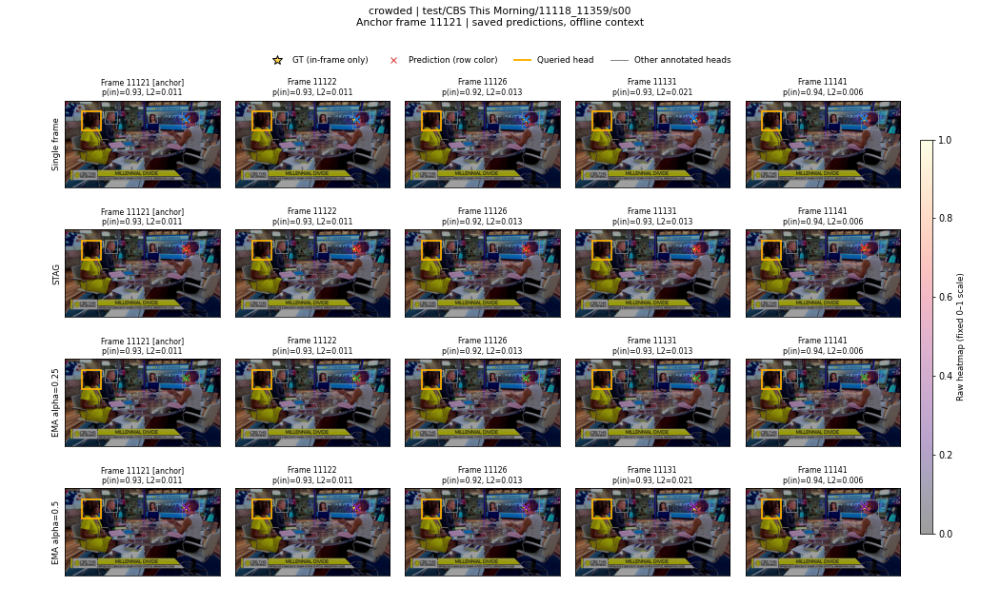
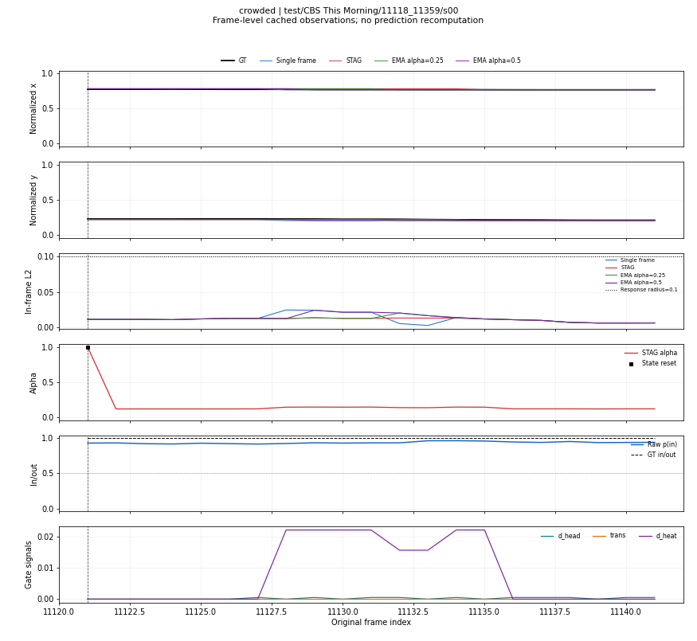

# T6 时序案例诊断

- T5 来源：`/home/fb/src/paper/gazelleV1/cscwd/results/t5_ema_ablation.json`。
- 仅显示已缓存预测；标签用于离线选样和计分，不修改预测。
- 热图统一使用原值色标 [0,1]；包括收益、失响应、滞后、稳定收益与拥挤场景。

| 类别 | 候选数 | 完整输出案例数 |
|---|---:|---:|
| stag_over_ema | 7 | 2 |
| single_frame_only | 5 | 5 |
| stag_lag | 11 | 2 |
| stable_gain | 726 | 2 |
| crowded | 16 | 2 |

## 已输出案例

| case_id | 类别 | track_id | 原帧号 | 上下文全局范围 |
|---|---|---|---:|---|
| stag_over_ema_96f0fc50a3877070 | stag_over_ema | test/CBS This Morning/2487_2818/s01 | 2517 | [3516,3547) |
| stag_over_ema_1c421f5b19eb9de7 | stag_over_ema | test/CBS This Morning/3446_3567/s00 | 3551 | [4240,4267) |
| single_frame_only_a2f1575f30b3f20b | single_frame_only | test/Downton Abby/13066_13217/s02 | 13190 | [6701,6732) |
| single_frame_only_9bd1cc7f8ed30e35 | single_frame_only | test/Hell's Kitchen/104235_104266/s01 | 104254 | [10421,10444) |
| single_frame_only_679c8fbd8c09f1d7 | single_frame_only | test/It's Always Sunny in Philadelphia/46470_46710/s01 | 46655 | [14412,14443) |
| single_frame_only_4b76dfb4660a5d91 | single_frame_only | test/It's Always Sunny in Philadelphia/46470_46710/s01 | 46696 | [14453,14478) |
| single_frame_only_5377cd78e01d64ff | single_frame_only | test/It's Always Sunny in Philadelphia/46470_46710/s02 | 46704 | [14702,14719) |
| stag_lag_bbc34ab341e623ee | stag_lag | test/CBS This Morning/12137_12258/s03 | 12144 | [1322,1350) |
| stag_lag_1346752560acc288 | stag_lag | test/CBS This Morning/12407_12648/s03 | 12474 | [2167,2198) |
| stable_gain_84f76562c98320b6 | stable_gain | test/CBS This Morning/11118_11359/s00 | 11128 | [0,28) |
| stable_gain_3204f959c5946bb9 | stable_gain | test/CBS This Morning/11118_11359/s00 | 11184 | [53,84) |
| crowded_7e45e09419c673db | crowded | test/CBS This Morning/11118_11359/s00 | 11121 | [0,21) |
| crowded_ba4dcbbdf191947c | crowded | test/CBS This Morning/12137_12258/s00 | 12137 | [956,977) |

## 小预览

### stag_over_ema · stag_over_ema_96f0fc50a3877070

### single_frame_only · single_frame_only_a2f1575f30b3f20b

### stag_lag · stag_lag_bbc34ab341e623ee

### stable_gain · stable_gain_84f76562c98320b6

### crowded · crowded_7e45e09419c673db

完整候选清单、逐帧数据和全分辨率图留在服务器，路径与 SHA256 见 JSON/provenance。
结合预览、原图与逐帧数据，判断旧峰残留、错误峰写入和门控触发机制。
