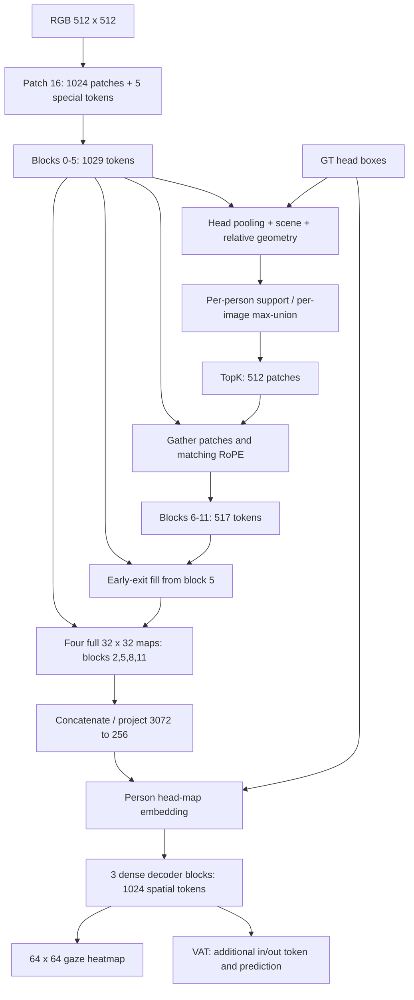

# E3：推理流程、计算量与优化顺序

日期：2026-11-24。依据当前 seed0 GF-B/VAT-B 的正式效率矩阵、现有源码，以及只读取回的旧 seed3106 分段报告。本轮没有新增 GPU forward、训练或计时，没有修改 `gazelle/` 或服务器正在运行的代码。

结论：K50 确实减少了后半段 backbone 的实际 token 计算；它没有让整条推理链减半。B8 相对同一路由 K100 的整批延迟下降约 20%，但当前 DINOv3 多层路由系统的额外成本抵消了相对官方 DINOv2 单层 GazeLLE 的大部分收益。B1 则几乎没有兑现 token 缩减的时间收益。优先做同权重阶段 profile 和保持预测语义的实现优化，不先重训 backbone 或新增 dense 训练。

## 1. 一次推理实际经过什么

以下用 ViT-B 说明。block 编号从 0 开始；多层指一次 backbone forward 中取四个位置，不是跑四次 backbone。

1. 输入纯 RGB 和当前帧的真实头框。图像 resize/normalize、读盘和图像 H2D 在本轮计时之外；forward 内的框处理、头图构建及相应 CPU/GPU 交互仍在计时内。没有深度、未来帧、检测框或时序状态。
2. `512/16=32`，得到 1,024 个 patch tokens；DINOv3 另有 CLS 和 4 个 storage tokens。前 6 个 blocks 对全部 1,029 tokens 计算，取第 2、5 层完整特征。冻结 backbone 只意味着不更新参数，推理仍须执行这些运算。
3. Router 在第 5 层特征上，根据头框池化头部外观，结合场景特征、框坐标、相对头中心的 dx/dy、绝对偏移与框宽高，预测每人的空间 support。当前代码使用空间 softmax。它不是用真实 gaze 坐标选择 patch；gaze 标注用于训练监督。
4. 同一图中各人的 support 逐位置取 max，形成 image-level union。头框格点和固定 escape 格点在同一个 K 预算内获得优先级，再 TopK 并排序。K50 最终恰好保留 512 个 patches，不是每人各跑 512 个，也不是 512 外再额外追加头部/escape patches。
5. gather 这 512 个 patch tokens 和它们原位置对应的 RoPE，保留 5 个 special tokens；后 6 个 blocks 只处理 517 tokens。前后段按图 batch 执行，多人共享一次 backbone。官方 GazeLLE 本来也按图共享 backbone，本方法额外共享的是经 union 选定的稀疏后段。
6. 第 8、11 层的 512 个深层 patch 特征 scatter 回原来 32×32 的位置，未选位置使用第 5 层特征作为 early-exit fill。不是填零，也不是后来补算被跳过的 blocks。四个输出都是完整网格。
7. 当前 `raw_concat + spatial_prior=none` 路径先把四层特征按人物 repeat，创建全一空间门并执行四次乘法，然后拼成 3,072 通道，1×1 卷积降到 256 通道。该路径没有 SASA、GGSF 或 auxiliary head。
8. 加空间位置编码与每人的 head-map embedding，再执行 3 层完整 decoder Transformer。GF 每人仍有 1,024 个空间 tokens；VAT 另加 1 个 in/out token。最后生成 64×64 gaze heatmap，VAT 同时生成 in/out 概率。Router 没有稀疏化这一段。

ViT-L 对应 24 个 blocks，前 12 层 dense、后 12 层 sparse，取 `[5,11,17,23]`，每层宽 1,024，四层拼接为 4,096 通道后降到 256。实际 L 效率须使用其自己的报告，不能由 B 的毫秒数推算。

官方 DINOv2 输入 448、patch 14，同样是 32×32=1,024 patches，另有 1 个 CLS。不能因我们的输入是 512 就说 Transformer 多了约 30% tokens。官方用最后单层特征，并且先按图降到 256 通道，再按人复制；我们的当前四层实现先复制高维特征再降维。

## 2. 计算量有没有减少

实际 block token trace 已验证：B 的前 6 层为 1,029，后 6 层 K50 为 517，K100 为 1,029。因此后段 Transformer 确实少计算了 patches，不只是最后乘了一个 mask。

下面是根据 token 数推导的算术估计，**不是跑出来的整网 FLOPs，也不是跨模型效率测量**。对于同一个 DINOv3，半数 blocks 不变、半数 blocks 缩短序列：

- 随 token 数线性增长的 QKV、输出投影和 MLP 主项，比例为 `(1 + 517/1029)/2 = 0.7512`，约减少 24.9%。
- Attention 的 QK/AV 二次项，比例为 `(1 + (517/1029)^2)/2 = 0.6262`，约减少 37.4%。
- 原生 B/L 都是 expansion ratio 4 的 MLP。按 `C(N,D)≈12ND²+2N²D` 估算 Transformer blocks 的主要 MACs，B/L 分别约减少 27.2%/26.7%。这未计 norms、RoPE、patch stem、Router、gather/scatter、网格回填、多层融合及 decoder。

因此，K50 不能表述为整网 FLOPs 减半；上述约 27% 也不能写成完整系统测得的计算量下降，更不能直接当作相对官方 GazeLLE 的 FLOPs 收益。整网统计须覆盖实际执行路径，包括融合和解码。

## 3. 实测为什么没有明显超过 GazeLLE

下表来自已回传的两个 B 模型正式报告。单位为整批 ms，正反运行顺序取几何平均。两个数据集分别在各自同一 GPU 上作内部比较。

| 模型 | Batch | 官方 | 路由 K100 | 路由 K50 | K100 相对官方的总成本差 | K100→K50 节省 | K50 相对官方的净延迟差 |
|---|---:|---:|---:|---:|---:|---:|---:|
| GF-B | 1 | 17.93 | 23.32 | 22.92 | +5.39 | 0.39 | +4.99 |
| GF-B | 8 | 53.38 | 67.38 | 53.82 | +14.00 | 13.56 | +0.44 |
| VAT-B | 1 | 17.94 | 21.86 | 21.73 | +3.92 | 0.13 | +3.79 |
| VAT-B | 8 | 51.60 | 63.22 | 50.34 | +11.62 | 12.88 | −1.26 |

表中的 K100−官方是整个配置与执行路径的合计成本差，包括底座、四层输出/融合、Router 和数据搬运等；不能将它标成“Router 本身耗时”。K100 仍执行路由和 gather/scatter，不是原生 DINOv3 dense。

GF-B B8 从 K100 到 K50 省了 13.56 ms，但我们的全 token 路径先比官方多花 14.00 ms，因而净结果基本持平。VAT-B B8 相同逻辑，只剩约 2.45% 的净延迟下降。B1 只有 0.13–0.39 ms 的缩减，抵消不了额外成本。

这反映两类问题：整条链有未被缩减的工作；缩减的工作也未必按 MACs 比例节省时间。序列变短并未减少 block 数、权重规模或算子启动次数。小 batch 下，内存读写、权重读取/转换、CPU 调度和大量小算子更可能限制速度，较小矩阵也可能降低 GPU 利用效率。B8 能更充分摊薄固定成本，当前实测才出现约 1.25× 的 K100→K50 加速。这些是有代码与趋势支持的解释，当前 checkpoint 各因素的具体毫秒占比仍须 profile 确认。

本轮关闭 AMP 权重缓存，模型 forward 内的转换开销也没有被人为移出计时。若调整缓存或部署精度策略，官方与我们需采用一致协议并重新验证输出，不能把协议改变的收益全部归给 Router。

显存也由峰值时刻同时存活的张量决定。suffix tokens 变少，四层完整网格、repeat 后的高维特征、全一乘法输出、cat 缓冲和完整 decoder 仍在。B8 实测 peak allocated 约 857 MiB、官方约 538 MiB；K50/K100 的峰值几乎相同。峰值具体出现在哪个算子，当前没有独立测量。

## 4. 耗时主要在哪里：已有历史分段证据

旧 seed3106 split-clean B1 报告已有 CUDA-event 分段诊断。本轮只读取得原报告并登记路径/SHA；随机输入、checkpoint 和 AMP cache 设置与当前 seed0 正式报告不同，不能冒充当前模型的分段计时。

| 历史阶段 | Forward：K100 / K50 ms | Reverse：K100 / K50 ms |
|---|---:|---:|
| 前 6 层 blocks | 7.171 / 7.150 | 8.775 / 9.005 |
| Router | 2.996 / 2.964 | 3.818 / 3.955 |
| 后 6 层 blocks | 7.183 / 6.790 | 8.808 / 8.732 |
| 四层融合及整个 decoder | 3.063 / 3.030 | 3.677 / 3.783 |
| gather/RoPE 准备 | 0.150 / 0.147 | 0.187 / 0.195 |
| 回填与归一化 | 0.351 / 0.387 | 0.446 / 0.482 |

旧诊断中，prefix/suffix 是绝对时间的大头；Router 约占插桩总时间的 13–14%，融合+decoder 约占 13–14%。K50 的 suffix 虽减半 patch 数，耗时分别只降低约 5.48% 和 0.86%，已表明 B1 的数学缩减不能直接转为等比例硬件加速。两个顺序的绝对时延不同，必须同时保留，不能挑其中较好的一次。

阶段 CUDA-event 数字受插桩影响，各阶段 median 也不能简单相加代替正式整网 latency。当前阶段判断依据至此：已知整网差额和静态执行成本，有历史 B1 诊断，但还没有当前选中 checkpoint 的分段结果。

## 5. 具体怎么改，先做什么

### 第一项：同 checkpoint 分段定位，不新增训练

沿用已有 `forward_profiled` 和计时设施，接入当前 compact checkpoint，B1/B8 分别测 prefix、Router、gather、suffix、回填/归一化、多层融合、decoder，并保留独立的无插桩完整 forward。补 native DINOv3 full-token 控制，使用同一 task weights；它是推理控制，不是新增 dense 训练。分清底座/融合的成本与路由工程成本，再决定改哪一段。

### 第二项：保持权重和预测语义的推理快路径

只在 `cscwd_router/code/` 新增 adapter/subclass，旧 `gazelle/` 不改。先限于当前实际使用的 `raw_concat + spatial_prior=none + aux off`：

1. 取消全一空间门的创建和四次乘法。数学上是 identity，但原门会影响中间 dtype，FP16 快路径需验证转换和数值行为。
2. 每图一人时跳过 `repeat/cat` 的无效复制；多人时先按图融合并投影到 256 通道，再按人物展开，随后保留每人的 head-map 条件化 decoder。这一配置的融合本身与人物无关，适合前移。
3. 缓存固定 32×32 坐标和 escape 索引，减少每次重建；减少 Router 逐图 mask/index 操作及框张量构建开销。输入相关的框处理仍应计入完整系统，不把工作挪出计时获得表面加速。
4. 根据实测决定是否进一步边生成边融合、减少四层特征和 cat 缓冲的同时存活。拆成多个小投影会增加算子启动，不预先认定更快。

原版/快路径比较覆盖 FP32/FP16、单图/批量、单人/真实多人，检查 heatmap、in/out、support 和选中索引，再复评精度和完整 forward 的速度/显存。改变 batch 运算组织可能带来浮点舍入差异，不能只凭代数等价声称逐值一致。没有完成这些运行前不填写优化收益。

### 第三项：实现优化后再改预算或结构

如果 B1 仍是小算子/调度主导，再比较更少算子启动、静态执行或算子融合的部署方式；双方使用相同部署策略。若瓶颈仍为 suffix 计算，再尝试更低保留率或更早路由，重新训练 Router/decoder 并验证定位与 coverage，backbone 保持冻结。更激进的 sparse decoder、层数/融合结构改变后移，它们会改变方法与精度，不能只替换推理脚本。

不把增大 batch 作为单帧 B1 延迟优化；B8 是独立吞吐场景。也不靠继续多训几轮来解决同一计算图的单次推理开销。先保留当前精度，削减已经在代码中确认的冗余，再决定是否需要精度—预算折中。

## 6. 证据与下一步

- 正式报告：[GF-B summary](efficiency_dinov3_seed0_20261124/gazefollow/vitb/summary.json)、[VAT-B summary](efficiency_dinov3_seed0_20261124_vatfix/vat/vitb/summary.json)、[E3-B 审查](E3_B_EFFICIENCY_REVIEW.md)。
- 历史分段报告来源/SHA、元数据、分段 median 和明确标注的理论推导：[说明证据](e3_efficiency_explanation_evidence.json)。
- 主要源码：`gazelle/routing/model.py`、`gazelle/routing/backbone.py`、`gazelle/routing/router.py`、`gazelle/model.py`、`gazelle/model_v0_dinov2.py`、`gazelle/utils.py`、`gazelle/ablation_variants.py`；本轮只读。
- 下一步只开一项：准备当前 checkpoint 的阶段 profile 与 native full-token 推理控制，保留完整计时；随后依据分段结果实现快路径。当前文件是说明和推进顺序，尚未实现优化或启动服务器实验，GF-L/VAT-L 原任务不受影响。
